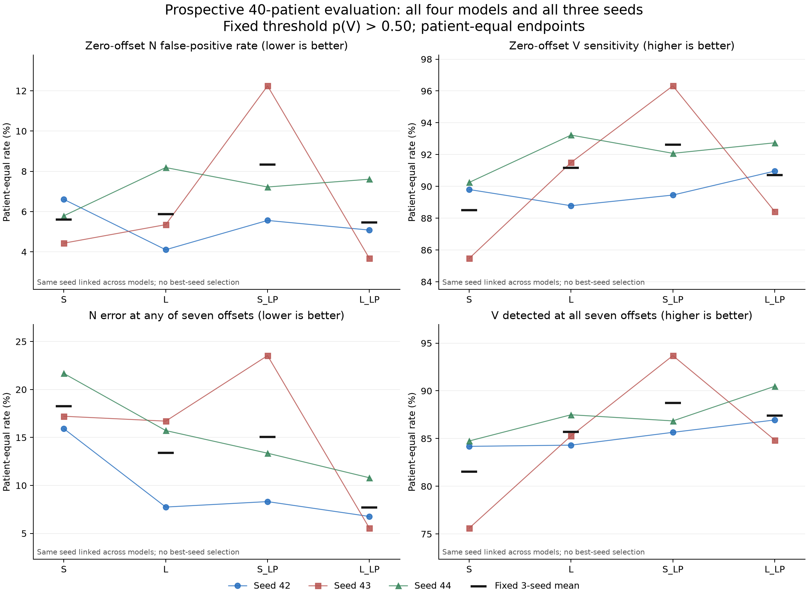
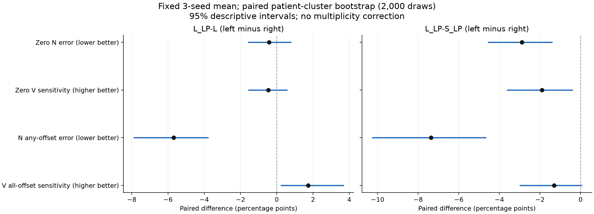

# 新增200患者：四格三种子与一次独立评价

本轮实际完成12项新数据训练及其开发评价，并在所有checkpoint、开发比较和恢复/预测审计冻结后，对预先隔离的40位新患者进行一次固定评价。以下判断只针对本次固定数据、网络、初始化和训练协议，不选择最好seed或强迫单一赢家。

**相同固定窗口训练下，低通是否改善大模型。**独立评价中，seed42/43/44原位N误判变化为 +5571 / -11309 / -2085，原位V检出变化为 -9 / -15 / -23；N任一偏移误判变化为 -5351 / -68786 / -21577，V全部偏移检出变化为 +34 / +24 / -20。患者等权原位V检出差为 +2.18pp / -3.08pp / -0.49pp，患者等权V全部检出差为 +2.64pp / -0.44pp / +2.98pp。负的N误判差为改善，正的V检出差为改善；必须同时读N代价、V收益、患者支持及下方三次原始结果。

**低通之后，扩大容量是否提供额外收益。**独立评价中，seed42/43/44原位N误判变化为 -3236 / -53138 / +2879，原位V检出变化为 +7 / -121 / +29；N任一偏移误判变化为 -9146 / -112296 / -16929，V全部偏移检出变化为 +21 / -138 / +46。患者等权原位V检出差为 +1.51pp / -7.90pp / +0.66pp，患者等权V全部检出差为 +1.30pp / -8.85pp / +3.63pp。负的N误判差为改善，正的V检出差为改善；必须同时读N代价、V收益、患者支持及下方三次原始结果。

上一轮旧数据下的四格结果只作历史背景，本轮没有重跑其冻结实验。新数据矩阵四格共享同一扩充数据、class-weight计算规则与训练/评价条件。相对上一轮，患者、总拍量、实际类权重、优化更新步数和dev患者都发生变化，因此本轮不把跨轮变化全部归因于患者多样性，也不是数据扩充单因素因果试验。

## 实际数据与曝光链

新增200人按120train/40dev/40independent冻结，每人最多4段；患者与段清单均先于新信号/标签内容获取。取得2399/2400个源文件，累计应用payload 1,711,225,364 B；唯一缺失train p09128_s49.atr在镜像和主站404，整段按统一完整性规则排除，患者及其余3段保留，不补人或补段。开发实际使用639个新增官方段加旧100段；独立集160段的480个文件先加密保管。

来源为[Icentia11k v1.0官方数据](https://physionet.org/content/icentia11k-continuous-ecg/1.0/)，250Hz胸部固定单导联；只使用字面N/V，Q/S等不改标。N是拍类型，不能当作患者健康。旧40人维持30train/10dev。

|集合|身份患者|N/V可拟合患者|N|V|有V患者|原位窗|共同七偏移窗|
|---|---|---|---|---|---|---|---|
|train|150|146|1986034|13109|90|1999143|1999127|
|dev|50|50|776938|6264|32|783202|783197|
|independent|40|39|591730|2277|18|594007|593999|

新增有V患者train75位、dev24位，均达到原覆盖建议；train四位无N/V身份保留但不拟合。没有1333/人机械上限，也未为了均衡删掉大量V。开发准备快照及完整患者清单见DATA_READINESS_REPORT.md与patient_roster_development_and_custody.csv；该快照的“未开封”指训练前时刻。

独立集于 2026-10-28T05:58:24+08:00 首次开启，晚于全部12项结束及冻结门。此后状态为CONFIRM_OPENED，不能在未来调参后把同一批人再次称为未见确认集。旧197个sealed atr始终未打开或哈希，历史EXPOSURE_UNVERIFIED不变。曝光链审计只覆盖已查本地记录，不能证明任何未记录外部历史访问都不存在；本机同账户下的加密、白名单与checkpoint门也不冒充第三方独立保管。

## 独立评价：全部12次原位结果

|run|N误判|V检出|患者等权N误判%|患者等权V检出%|AUC|AP|
|---|---|---|---|---|---|---|
|S_C_s42|39058|2117|6.60703|89.80454|0.98194|0.75732|
|L_C_s42|24840|2107|4.10704|88.78597|0.98177|0.57764|
|S_LP_C_s42|33647|2091|5.56172|89.45622|0.98140|0.62407|
|L_LP_C_s42|30411|2098|5.08269|90.96369|0.98013|0.49052|
|S_C_s43|26054|2029|4.43366|85.47390|0.97257|0.49452|
|L_C_s43|32958|2083|5.35203|91.50265|0.97904|0.61942|
|S_LP_C_s43|74787|2189|12.24421|96.32040|0.98214|0.68410|
|L_LP_C_s43|21649|2068|3.67654|88.42230|0.98574|0.79603|
|S_C_s44|34628|2008|5.79243|90.24947|0.96816|0.35847|
|L_C_s44|48035|2122|8.18803|93.22686|0.97289|0.36723|
|S_LP_C_s44|43071|2070|7.22203|92.07937|0.97537|0.78456|
|L_LP_C_s44|45950|2099|7.60914|92.74153|0.98017|0.79486|

零偏移分母：N=591,730、V=2,277，共594,007窗。单类或无N/V患者保留身份，未定义指标留空；宏AUC/AP只汇总同时有两类者。AUC/AP描述排序，不能替代固定阈值计数，也不等于真实设备报警表现。

## 独立评价：七偏移稳健性

|run|N任一误判|V全部检出|等权N任一%|等权V全部%|最差统一N偏移|最差统一N误判|最差统一V偏移|最差统一V检出|
|---|---|---|---|---|---|---|---|---|
|S_C_s42|100253|2039|15.91369|84.18197|-4|60579|0|2117|
|L_C_s42|46371|2026|7.74783|84.30953|-2|28696|4|2074|
|S_LP_C_s42|50166|2039|8.31648|85.65097|1|34621|4|2075|
|L_LP_C_s42|41020|2060|6.76604|86.94617|-2|32986|4|2089|
|S_C_s43|105807|1869|17.21234|75.61100|2|69528|4|1974|
|L_C_s43|101914|1990|16.70309|85.27974|-4|66514|1|2077|
|S_LP_C_s43|145424|2152|23.53247|93.68925|-4|114036|1|2184|
|L_LP_C_s43|33128|2014|5.54825|84.84331|-1|24367|4|2047|
|S_C_s44|138993|1911|21.67206|84.74629|-4|100178|4|1982|
|L_C_s44|87167|2068|15.72230|87.49157|2|62174|4|2108|
|S_LP_C_s44|82519|2002|13.36204|86.84894|2|60438|4|2059|
|L_LP_C_s44|65590|2048|10.80127|90.47572|-4|50559|4|2071|

七偏移共同分母N=591,722、V=2,277；相对零偏移排除N=8、V=0。七偏移{-4,-2,-1,0,+1,+2,+4}使用预先固定几何共同集合；N任一误判与V全部检出按每拍七个位置联合统计，最差统一偏移则要求所有拍使用同一个delta，两者不可混称。分母、排除身份、每患者各delta与双向变化均有保存。

## 同seed差值：左臂减右臂

|pair|seed|ΔN原位误判|ΔV原位检出|ΔN任一误判|ΔV全部检出|Δ等权N原位pp|Δ等权V原位pp|
|---|---|---|---|---|---|---|---|
|L_LP-L|42|5571|-9|-5351|34|0.97564|2.17772|
|L_LP-L|43|-11309|-15|-68786|24|-1.67549|-3.08035|
|L_LP-L|44|-2085|-23|-21577|-20|-0.57889|-0.48533|
|L_LP-S_LP|42|-3236|7|-9146|21|-0.47903|1.50747|
|L_LP-S_LP|43|-53138|-121|-112296|-138|-8.56767|-7.89810|
|L_LP-S_LP|44|2879|29|-16929|46|0.38711|0.66216|
|S_LP-S|42|-5411|-26|-50087|0|-1.04531|-0.34832|
|S_LP-S|43|48733|160|39617|283|7.81055|10.84650|
|S_LP-S|44|8443|62|-56474|91|1.42960|1.82990|
|L-S|42|-14218|-10|-53882|-13|-2.49999|-1.01857|
|L-S|43|6904|54|-3893|121|0.91837|6.02875|
|L-S|44|13407|114|-51826|157|2.39560|2.97739|

主配对为L_LP-L和L_LP-S_LP；S_LP-S与L-S为预先声明背景。没有挑选最好seed、阈值或看起来更好的单一指标。

## 患者聚类区间与不确定性

|pair|endpoint|三seed均值差pp|95%下限pp|95%上限pp|支持患者|有效重抽样次数|
|---|---|---|---|---|---|---|
|L_LP-L|macro_N_false_positive_rate|-0.42624|-1.56299|0.77083|39|2000|
|L_LP-L|macro_V_detection_rate|-0.46265|-1.54981|0.55278|18|2000|
|L_LP-L|macro_N_any_wrong_rate|-5.68589|-7.87707|-3.79408|39|2000|
|L_LP-L|macro_V_all_detected_rate|1.72812|0.24722|3.66884|18|2000|
|L_LP-S_LP|macro_N_false_positive_rate|-2.88653|-4.54369|-1.42154|39|2000|
|L_LP-S_LP|macro_V_detection_rate|-1.90949|-3.59774|-0.41390|18|2000|
|L_LP-S_LP|macro_N_any_wrong_rate|-7.36515|-10.25682|-4.68408|39|2000|
|L_LP-S_LP|macro_V_all_detected_rate|-1.30798|-2.98145|0.05040|18|2000|

按患者身份成簇配对重抽样2000次，所有拍和三个seed留在该患者簇内；seed固定，未把3×40当成120位独立患者。区间未做多重比较校正，仅为描述性区间，不据其中任一好看的区间宣布显著性赢家。逐seed区间及所有背景配对完整见independent_paired_intervals.csv。少量V患者/少量V拍会造成较大比例波动；数量目标不是统计充分性的保证。

## 患者代价与完整原始表

L_LP-L：用于解释N计数差及V比例差较大的患者，非数据/模型选择规则。所有40人仍完整保留在CSV中。

|patient|42 ΔN/ΔV|43 ΔN/ΔV|44 ΔN/ΔV|
|---|---|---|---|
|p07893|1435 / 0|-3544 / 0|3414 / 0|
|p02268|5772 / 1|1316 / -14|-754 / -9|
|p02760|-356 / 0|-4992 / 0|-1746 / 0|
|p06728|2 / 1|-4 / -1|-263 / 0|
|p02174|-11 / 1|-79 / -1|74 / 0|

L_LP-S_LP：用于解释N计数差及V比例差较大的患者，非数据/模型选择规则。所有40人仍完整保留在CSV中。

|patient|42 ΔN/ΔV|43 ΔN/ΔV|44 ΔN/ΔV|
|---|---|---|---|
|p02760|-1034 / 0|-10184 / 0|2788 / 0|
|p02268|3103 / 8|-7679 / -44|149 / 8|
|p07893|1466 / 0|-5930 / 0|1778 / 0|
|p06728|-26 / 1|-112 / -1|-66 / 0|
|p02231|-26 / -1|-930 / -61|63 / 19|

完整逐患者支持、N/V计数、最差/任一/全部条件和AUC/AP在independent_patients.csv；逐条件p、margin、身份在independent/<run>/eval_*/*.npz。个别差异不证明唯一生理机制。

## 开发结果、实际预算与恢复

|run|停止轮|最佳轮|保留状态更新|最佳更新|尝试次数|已记录尝试分钟|尝试计时口径|TF末次进程峰值MiB|RSS末次进程峰值MiB|
|---|---|---|---|---|---|---|---|---|---|
|S_C_s42|15|3|117150|23430|1|227.97380|完整墙时|184.93188|9233.20312|
|L_C_s42|15|3|117150|23430|1|243.05155|完整墙时|656.79980|9275.19922|
|S_LP_C_s42|17|5|132770|39050|1|258.42277|完整墙时|185.22412|9286.85156|
|L_LP_C_s42|15|3|117150|23430|1|243.28341|完整墙时|703.04175|9299.19922|
|S_C_s43|16|4|124960|31240|1|230.58146|完整墙时|183.80859|9231.46094|
|L_C_s43|14|2|109340|15620|1|219.82888|完整墙时|656.80078|9308.56641|
|S_LP_C_s43|14|2|109340|15620|2|220.84194|含中断，仅为下界|185.50073|9182.07812|
|L_LP_C_s43|15|3|117150|23430|2|235.82488|含中断，仅为下界|638.94604|9192.85938|
|S_C_s44|13|1|101530|7810|1|169.17670|完整墙时|183.85474|9255.34766|
|L_C_s44|14|2|109340|15620|2|288.35185|完整墙时|630.00635|9158.92969|
|S_LP_C_s44|13|1|101530|7810|1|168.11908|完整墙时|185.21875|9282.37109|
|L_LP_C_s44|13|1|101530|7810|1|183.75011|完整墙时|654.41846|9327.76953|

正式矩阵开始 2026-10-26T08:55:15+08:00，训练/开发评价终态 2026-10-28T05:55:25+08:00，独立评价终态 2026-10-28T06:43:34+08:00，均为北京时间。每轮7,810更新、最多80轮、patience12/min_delta1e-4；实际总样本与更新如表。TF allocator峰值不等于驱动总显存；gpu_observations.csv含桌面等驱动占用，且只是抽样而非连续峰值。

进程中断恢复：S_LP_C_s43原进程丢失时，最后完整快照为第10轮，第11轮至少已执行2,048个batch更新但未形成完整快照。从第10轮的模型、Adam、Dropout及采样RNG原状恢复并重放第11轮；前六项未重跑，数据与冻结训练核心hash复核一致。恢复时只修正调度脚本跨重启的尝试计数并接回尚未执行的等待流程，数值训练实现未变。中断原因和原退出码未知，当前Linux运行时长重置已有记录。表中‘保留状态更新’及development_runs.csv完整轮次耗时不包含被丢弃的部分轮更新；实际执行总量更高，精确丢弃数量未知。中断尝试时长只能由最后遥测给出下界，不能当成完整精确运行时长。末次进程峰值不冒充多次进程的连续峰值，原第10轮恢复点另有字节一致备份。证据见process_interruption_20261027.json。

旧10dev与新40dev均参与选模，不能称盲测。development_runs.csv、development_same_seed_pairs.csv分别提供旧/新/合并三种口径，development_comparison_frozen.json证明开发结果先于独立开启冻结。完整epoch快照保存模型、Adam、采样RNG、Dropout、epoch/best/wait；training_recovery_audit.json已加载核对12项完整状态和全部180份固定诊断预测（96份dev预测及84份旧train病例预测）。best_model.keras为推理模型，完整续训须用epoch快照加state.json。independent_prediction_audit.json重新核对96份独立预测、身份、计数、重复和BN不变。

## 可以和不能推断的范围

低通同时改变频率响应与有效感受野，不能从这四格认定混叠为唯一根因。更多患者和更分散标签支持不自动证明形态多样性；本轮也增加拍数、更新数并按同一规则重算实际类权重，跨轮数据收益不是单因素因果结论。三seed用于观察训练随机性，独立患者数仍是40。无事前临床容忍差，不强迫单一赢家。

参考标注锚点绕过了检测器；1秒上下文窗不是已证明的纯QRS归因。N/V拍级误判不能换算成每小时报警，S/Q及AF/VF不混入两输出。本轮没有验证真实AFE保真、设备/INT8、AF/VF或部署，没有修改产品仓、GitHub PR/README、串口/刷写或其他agent的加速/ESP-DL工作。公共数据胸部单导联的新患者识别结果不能替代这些验证。

固定范围到此结束，不自动增加患者、段数、模型、剂量、seed或下一轮训练。

关键交付：patient_split_frozen.csv/json、segments_frozen.json、acquisition_ledger.json、development_qc.json、frozen_config.json、initializations.json、12个run最佳模型及恢复快照、开发与独立逐窗预测/统计、两类审计、全部同seed差值及描述性区间、delivery_manifest.json。
